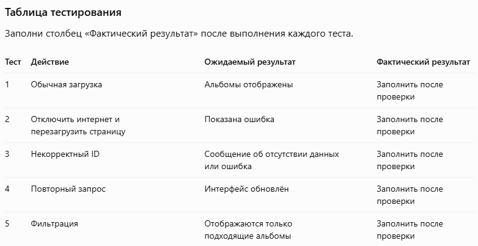

3. Контрольные вопросы с ответами
8. Что такое AJAX и REST API?

AJAX — подход, позволяющий обмениваться данными с сервером без полной перезагрузки страницы. REST API — интерфейс взаимодействия с сервером через HTTP-запросы и ресурсы.

9. Чем асинхронный запрос отличается от синхронного?

Асинхронный запрос не блокирует выполнение остального JavaScript на время ожидания ответа. Синхронный запрос блокирует выполнение, что может приводить к зависанию интерфейса.

10. Что возвращает fetch()?

fetch() возвращает Promise, который при успешном выполнении запроса разрешается объектом Response.

11. Для чего нужен async/await?

Он позволяет удобно писать асинхронный код в последовательном стиле и обрабатывать результаты Promise.

12. Почему следует проверять response.ok?

Потому что HTTP-ошибки, например 404 или 500, сами по себе обычно не приводят к отклонению Promise от fetch().

13. Что делает response.json()?

Асинхронно читает тело ответа и преобразует JSON в JavaScript-объект или массив.

14. Как обрабатывать ошибки сети?

Использовать try/catch, показывать пользователю понятное сообщение и предоставлять возможность повторить запрос.

15. Что такое CORS?

CORS — механизм браузера, который регулирует доступ веб-страниц к ресурсам другого источника. Сервер должен разрешить такой доступ соответствующими HTTP-заголовками.

16. Чем отличаются GET и POST?

GET обычно используют для получения данных, POST — для отправки данных на сервер, например для создания ресурса.

17. Почему нельзя полностью доверять содержимому ответа сервера?

Данные могут быть неожиданными, неполными или некорректными. Их следует проверять и безопасно вставлять в DOM.

18. Как показать индикатор загрузки?

До запроса установить текст вроде «Загрузка…», а после получения результата заменить его данными или сообщением об ошибке.

19. Для чего нужен AbortController?

Он позволяет отменять выполняющиеся запросы, например при выборе другого альбома до завершения предыдущей загрузки.

В ходе лабораторной работы было разработано веб-приложение «Каталог альбомов», использующее HTML, CSS, JavaScript и Fetch API. Реализована асинхронная загрузка списка альбомов и фотографий выбранного альбома с использованием публичного REST API JSONPlaceholder. Для обработки запросов применены async/await, проверка HTTP-ответов и обработка ошибок с помощью try/catch. Интерфейс обновляется без перезагрузки страницы. Дополнительно реализованы поиск и фильтрация альбомов. В результате были изучены принципы асинхронного взаимодействия с сервером, обработки JSON и динамического изменения DOM.

таблица тестирования
